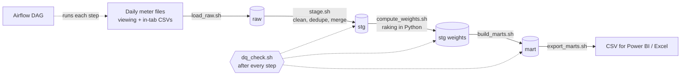
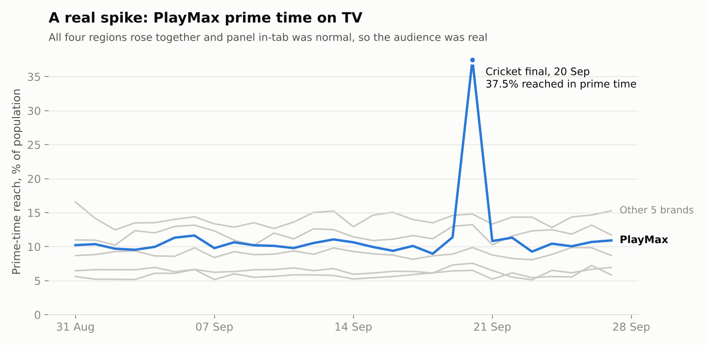
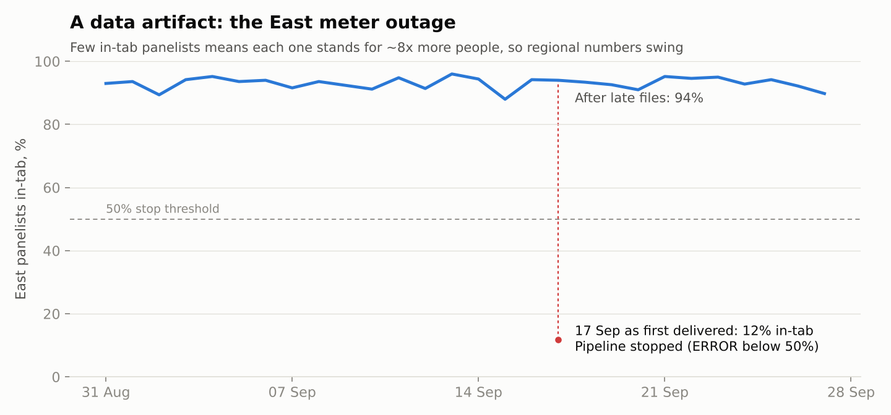
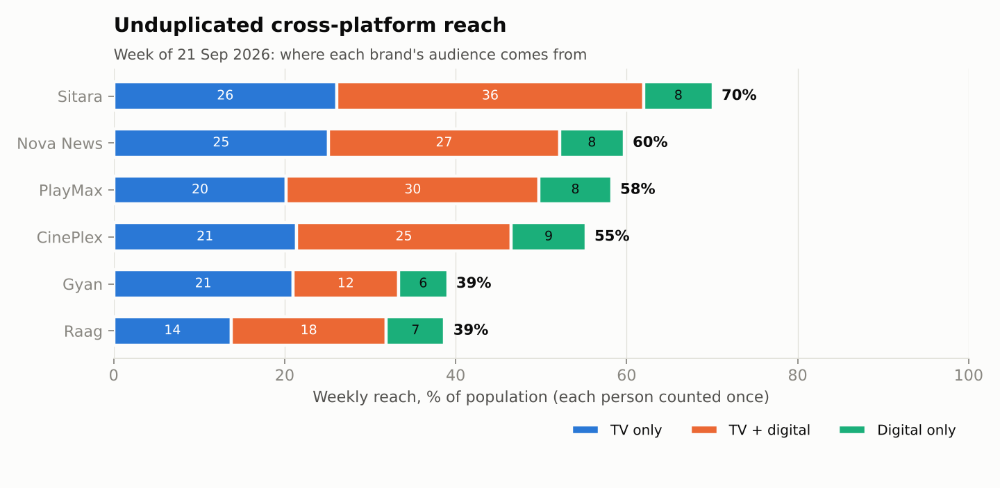

# Audience Measurement Pipeline (TV + Digital Panel)

An end-to-end analytics pipeline that turns raw people-meter panel data into
audience estimates: **reach, ratings, share, frequency and de-duplicated
cross-platform reach** across TV, Digital, Mobile and OTT.

Built with **SQL (PostgreSQL), shell scripts, Python and Apache Airflow**,
with automated data-quality checks and a written SOP.

> **About the data.** Real panel data (Comscore, BARC, Nielsen) is
> proprietary, so `scripts/generate_panel_data.py` creates a realistic
> synthetic panel: 1,200 households, 2,882 panelists, 28 days, ~159k raw
> viewing events, plus the problems real feeds have (duplicates, bad
> timestamps, unknown brand codes, a file re-delivery, a regional meter
> outage). All brands and numbers are fictional.

---

## What it does



| Step | What happens | Where |
|---|---|---|
| Load | Land daily files as-is (all text) with file name + load time. Re-loading a file replaces it, never duplicates it. | `bin/load_raw.sh` |
| Stage | Standardise spellings (`"SITARA TV"` → Sitara, `"CTV"` → OTT); reject invalid rows with a reason; remove duplicates; cap "TV left on" sessions at 4h; merge overlapping session fragments (gaps-and-islands with window functions). | `sql/02_stage_intab.sql`, `sql/03_stage_viewing.sql` |
| Weight | Panel over-represents young people and the South, and some meters fail each day. Raking gives each in-tab panelist a weight so the panel matches the population on age, gender and region. | `scripts/rake_weights.py` |
| Marts | Daily reach / AMA / rating / share by brand × platform × daypart × demo; weekly reach + frequency; weekly unduplicated cross-platform reach. | `sql/04_mart_daily.sql`, `sql/05_mart_weekly.sql` |
| Check | ~30 checks per day, 16 per week. ERROR stops the pipeline before bad numbers are published; WARN is logged. | `sql/dq/*.sql`, `bin/dq_check.sh` |
| Orchestrate | One Airflow run per broadcast day; weekly tasks on Sundays; retries for late files. | `airflow/dags/audience_measurement_dag.py` |

Metric definitions: [docs/METRICS.md](docs/METRICS.md) · How to run and
handle failures: [docs/SOP.md](docs/SOP.md) · Worked investigations:
[docs/INVESTIGATIONS.md](docs/INVESTIGATIONS.md) · Power BI + Excel:
[docs/REPORTING_GUIDE.md](docs/REPORTING_GUIDE.md)

---

## Results

**A real spike vs a data artifact** - the two investigations in
[docs/INVESTIGATIONS.md](docs/INVESTIGATIONS.md):





**Cross-platform reach.** Adding TV, Digital, Mobile and OTT reach together
would double-count people who used more than one platform. The pipeline
counts each person once:



Run summary (28 days): 159,175 raw rows → 150,103 clean sessions;
2.7% removed (2,283 duplicates, 2,050 invalid rows, each with a reason in
`audit.rejected_events`); 4,739 overlapping fragments merged; average design
effect from weighting 1.09.

---

## Quick start

### Option A - Docker (Windows / Mac / Linux)

Needs [Docker Desktop](https://www.docker.com/products/docker-desktop/) and ~4 GB free RAM.

```bash
git clone <this repo> && cd audience-measurement-pipeline
docker compose up -d --build                 # Postgres + Airflow
docker compose exec airflow bash             # shell inside the container

# inside the container:
python3 scripts/generate_panel_data.py       # create the synthetic data
bin/run_pipeline.sh                          # run all 28 days
```

### Option B - no Docker (Linux, macOS, or WSL on Windows)

Needs PostgreSQL 14+, `psql`, Python 3.10+, bash.

```bash
pip install -r requirements.txt
cp .env.example .env                         # edit DB settings if needed
python3 scripts/generate_panel_data.py
bin/run_pipeline.sh
```

If a script says `Permission denied`, run `chmod +x bin/*.sh` (or prefix
commands with `bash`, e.g. `bash bin/run_pipeline.sh`).

### What you should see

The run **stops on 2026-09-17** with:

```
ERROR | intab_critical_east | 11.82 | 50 | Region in-tab collapsed - likely meter data outage in East
```

That is deliberate - it is the planted meter outage. Follow
[SOP section 6](docs/SOP.md#6-restating-a-day-late-or-corrected-files):
the late files are in `data/late_delivery/`.

```bash
cp data/late_delivery/viewing/*.csv data/raw/viewing/
cp data/late_delivery/intab/*.csv   data/raw/intab/
bin/run_pipeline.sh --start 2026-09-17       # restate that day and finish the run
bin/run_analysis.sh                          # investigation queries -> exports/analysis/
python3 scripts/make_charts.py               # charts -> docs/img/
```

### Airflow

Open http://localhost:8080 (login: `docker compose logs airflow | grep -i password`),
switch on `audience_measurement_daily`, and it runs every day from 31 Aug to
27 Sep in order. Each task calls the same shell script you ran by hand.

---

## Project layout

```
bin/                    shell scripts - every step is runnable on its own
  run_pipeline.sh       run everything (or --date / --start / --end)
  load_raw.sh  stage.sh  compute_weights.sh  build_marts.sh
  dq_check.sh           run checks, exit 1 on any ERROR
  run_query.sh          turn any .sql file into a CSV-producing job
  export_marts.sh  run_analysis.sh  init_db.sh  reset_db.sh  common.sh
sql/
  00_schema.sql         raw / ref / stg / mart / audit schemas
  01_seed_reference.sql platform aliases, dayparts
  02-05_*.sql           staging and marts
  dq/                   data-quality checks
  analysis/             investigation + report queries
scripts/
  generate_panel_data.py  synthetic panel + planted problems
  rake_weights.py         panel weighting (iterative proportional fitting)
  make_charts.py          README charts
airflow/dags/           the DAG
docs/                   SOP, metric definitions, investigations, Power BI guide
docker-compose.yml      Postgres 16 + Airflow 3
```

## Data model

| Table | Grain | Notes |
|---|---|---|
| `raw.viewing_events`, `raw.intab` | one row per row in a file | text only, plus `source_file`, `loaded_at` |
| `stg.viewing_sessions` | one clean viewing session | merged fragments counted in `n_source_records` |
| `stg.daily_intab` | panelist × day | `is_intab` = usable for measurement |
| `stg.daily_weights`, `stg.weekly_weights` | panelist × period | sum to the 40M universe |
| `mart.daily_brand_daypart_demo` | day × platform × brand × daypart × age × gender × region | additive across demo cells only |
| `mart.weekly_brand_reach_demo` | week × platform × brand × demo | reach + average days viewed |
| `mart.weekly_cross_platform_reach` | week × brand × demo | TV only / digital only / both |
| `audit.*` | run log, rejected rows, DQ results, weighting diagnostics | |

**Reach is not additive** across dayparts, days or platforms - the same
person can appear in several. Sum reach only across demo cells, and use the
views (`mart.v_daily_brand_daypart`, `mart.v_weekly_cross_platform`) or the
weekly tables for anything else.

## Design decisions

- **Shell + SQL per step, Airflow on top.** Any step can be run, re-run or
  debugged by hand; Airflow only orders and retries them.
- **Idempotent everything.** Every step deletes its own output for the
  period before writing, inside a transaction. Re-running is always safe,
  which is what makes restatements easy.
- **Stop before publishing.** ERROR checks run before the next layer is
  built, so a collapsed panel never reaches a report.
- **Keep the evidence.** Rejected rows are stored with a reason, weights with
  diagnostics, and checks with observed vs threshold values.
- **Projected universe per demo cell.** Raking matches age, gender and region
  totals exactly; single cells can drift, so cell-level reach % uses the sum of
  weights in the cell and can never exceed 100%.

## Possible next steps

- Store raw files in S3 and run Postgres on AWS RDS (see `docs/SOP.md` §10)
- Program-level ratings from a schedule table
- Confidence intervals from the effective sample size
- dbt models in place of plain SQL files
